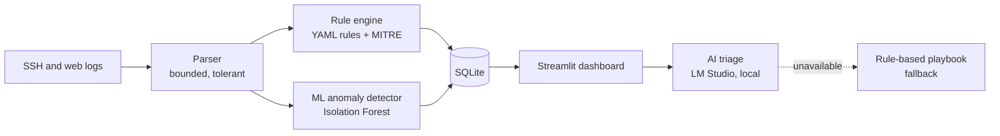

# SOC Log Analyzer

A small SOC (Security Operations Centre) toolkit that reads SSH and web server logs, detects suspicious
activity with **rule-based detection and machine learning**, maps alerts to **MITRE ATT&CK**, and explains each
alert with an **AI assistant that runs locally** (LM Studio). Built with Python, pandas, scikit-learn,
SQLite and Streamlit.

> Your logs never leave your machine: the AI model runs on your own PC through LM Studio.

## Features

- **Rules as code.** Detection rules live in [`rules/default_rules.yaml`](rules/default_rules.yaml) and are validated at startup. Change a threshold or add a rule without touching Python.
- **Five detections:** SSH brute force, username enumeration, successful login after repeated failures, web scanning (404 bursts) and SQL injection / XSS / path traversal patterns (with double URL-decoding to catch encoding tricks).
- **ML anomaly detection.** An Isolation Forest on per-IP, per-5-minute behaviour finds unusual activity that no rule describes, such as a request flood made of perfectly valid requests, and says which feature made it unusual.
- **MITRE ATT&CK mapping** on every rule alert, with links to the technique pages.
- **AI-assisted triage.** Select an alert and get a plain-language explanation, likely attack, false-positive likelihood and defensive next steps from a local LLM. Advisory only.
- **Resilient by design:** bounded line length, tolerant decoding, streaming file parser, O(n log n) window search, atomic database writes, schema-validated model output and automatic fallback to rule-based explanations when the model is unavailable.
- **Tested:** 75 automated tests, including a fake LM Studio server for the AI paths, run on every push by GitHub Actions.

## Architecture



## Quick start

```bash
git clone <your-repo-url>
cd soc-log-analyzer
pip install -r requirements.txt
streamlit run app.py
```

Click **Run analysis** in the sidebar. Sample logs are included (`sample_data/`), and `python scripts/generate_logs.py` recreates them.

### Enable AI triage (LM Studio)

1. Install [LM Studio](https://lmstudio.ai) and load any chat model.
2. Start the local server (Developer tab, default `http://localhost:1234`).
3. In the dashboard sidebar type the model name shown in LM Studio (for example `google/gemma-4-26b-a4b-qat`), press **Check connection**, select an alert in the table and click **Explain with local AI**.

Settings can also come from environment variables: `SOC_LLM_BASE_URL`, `SOC_LLM_MODEL`, `SOC_LLM_TIMEOUT` (default 120 seconds, since large local models can be slow).
Reasoning models are supported: the reply is parsed for the final JSON answer even if the model prints its thinking first.
Without LM Studio everything else keeps working and the explanation comes from the rule playbook.

### Docker

```bash
docker build -t soc-log-analyzer .
docker run -p 8501:8501 soc-log-analyzer     # reaches LM Studio on the host via host.docker.internal
```

## Rules as code

```yaml
- id: R1
  name: SSH brute-force attempt
  type: threshold            # threshold | distinct | success_after_failures | pattern
  source: ssh
  event: failed_login
  threshold: 5
  window_minutes: 5
  severity: High
  mitre: {id: T1110, name: Brute Force, tactic: Credential Access}
  playbook:
    - Block or rate-limit the source IP at the firewall
```

| Rule | Detects | Severity | MITRE ATT&CK (indicative) |
|---|---|---|---|
| R1 | SSH brute force | High | T1110 Brute Force |
| R2 | Username enumeration | Medium | T1087 Account Discovery |
| R3 | Successful login after repeated failures | Critical | T1078 Valid Accounts |
| R4 | Web scanning | Medium | T1595.003 Wordlist Scanning |
| R5 | SQLi / XSS / path traversal | High | T1190 Exploit Public-Facing Application |

## Evaluation

Measured on the bundled synthetic dataset (`python scripts/evaluate.py`): 93 IP addresses, 7 of them attackers,
reproducible with a fixed seed. Results are at IP level.

| Detector | IPs flagged | True positives | Precision | Recall | F1 |
|---|---|---|---|---|---|
| Rules only | 6 | 6 | 1.00 | 0.86 | 0.92 |
| ML only | 7 | 4 | 0.57 | 0.57 | 0.57 |
| Rules + ML | 10 | 7 | 0.70 | 1.00 | 0.82 |

The rules are precise but cannot see a request flood made of valid requests. The ML detector finds it, at the
cost of some false alarms, which is why ML alerts are labelled Low or Medium and are meant to be triaged by an analyst.
These numbers come from synthetic data and show how the components behave together, not accuracy on real traffic.

Performance: about 110,000 log lines are parsed and analysed (rules and ML) in roughly 2 seconds on a laptop-class machine.

## Security design for the AI component

Log text is attacker-controlled, so a log line can contain instructions aimed at the model (prompt injection).

- The model never sees raw log lines, only a small JSON summary whose fields are cleaned and length-limited.
- The system prompt tells the model that every field is data and must not be obeyed.
- Replies must be JSON matching a schema (allowed values, clamped lengths); anything else is discarded.
- The AI is advisory: it cannot block an IP or change any setting.
- Timeouts, errors and bad replies fall back to a deterministic explanation, labelled as such in the interface.

## Testing

```bash
pip install -r requirements-dev.txt
python -m pytest -q
```

## Project structure

```
app.py                 Streamlit dashboard
soc/parser.py          log parsing (bounded, streaming)
soc/rules.py           YAML rule loading and validation
soc/detector.py        rule engine
soc/anomaly.py         Isolation Forest anomaly detection
soc/ai_triage.py       LM Studio client, sanitising, validation, fallback
soc/db.py              SQLite storage (atomic writes)
rules/                 detection rules as YAML
scripts/               log generator and evaluation
tests/                 75 tests
```

## Limitations and roadmap

- Batch analysis only; real-time log tailing is planned.
- IPv4 only; OpenSSH syslog and common web log formats only.
- Fixed thresholds miss slow-and-low attacks spread over a long period or many addresses.
- Sample data is synthetic. Planned: evaluation on public real-world log datasets.
- Planned: Sigma rule import, IP reputation enrichment, alert status workflow.

## License

MIT
